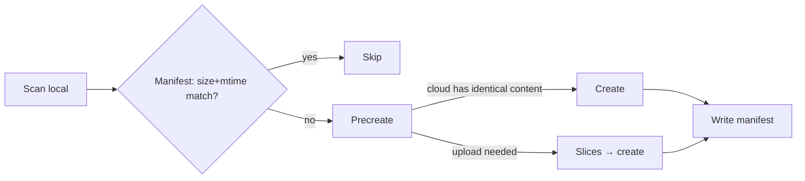

<p align="center">
  <picture>
    <source media="(prefers-color-scheme: dark)" srcset="docs/images/banner-dark.svg">
    
  </picture>
</p>

<p align="center"><sub>Log in · list · upload · sync · verify</sub></p>

<p align="center">
  <a href="https://github.com/CSGrandeur/allpango/releases/latest"></a>
  <a href="go.mod"></a>
  <a href="#install"></a>
  <a href="LICENSE"></a>
</p>

<p align="center">
  <a href="README.md">简体中文</a> · <b>English</b>
  <br>
  <a href="#install">Install</a> · <a href="#log-in">Log in</a> · <a href="#usage">Usage</a> · <a href="#sync-and-verify">Sync &amp; verify</a> · <a href="#limits">Limits</a> · <a href="#faq">FAQ</a>
</p>

<br>

allpango backs up a local directory to Baidu Netdisk: it uploads new and changed files, skips unchanged ones, and records empty files instead of failing. A single static binary with no runtime dependencies; it never deletes or moves remote files. Baidu Netdisk is the first supported disk; later disks will share the same commands.

## Features

- **Device-code login.** No callback URL; the access token refreshes before expiry and the new refresh token is written back atomically.
- **Official upload flow.** Precreate → slices → create; `rtype=3` overwrites the same name instead of producing `name(1)`; slice size grows automatically when the count would exceed the limit.
- **Incremental sync.** A local manifest records size and mtime of uploaded files; unchanged files are not re-queried. Losing the manifest costs speed, not correctness.
- **Independent verification.** `verify` lists the cloud recursively and compares size and mtime per file, without the manifest; `sync --seed` rebuilds the manifest from the cloud listing; `--seed-legacy` matches by size only, for taking over directories uploaded by other tools whose timestamp semantics differ.
- **Explicit failure.** Credentials, token, and directories must be given explicitly; exit 0 on success, non-zero on failure.

## Install

Requires Go 1.22+, or download the static binary for your platform from [Releases](https://github.com/CSGrandeur/allpango/releases/latest).

```bash
go build -o allpango ./cmd/allpango
```

## Log in

Create an app on the [Baidu Netdisk Open Platform](https://pan.baidu.com/union/console/applist) and put its keys in a credentials file:

```json
{ "app_key": "your AppKey", "app_secret": "your SecretKey" }
```

```bash
allpango login --cred cred.json --token token.json
```

The program prints a user code and a verification URL; sign in to your Baidu account in a browser and enter the code. The token is written to `token.json` (0600) and refreshed automatically afterwards. Credentials and tokens are read only from the files you name — never printed, never built in.

> [!NOTE]
> An app can only write under its own `/apps/<appname>` directory. To upload into an existing backup directory, use the keys of the app that created it.

## Usage

```bash
allpango quota  --cred cred.json --token token.json
allpango ls     --cred cred.json --token token.json --path /apps/<appname>/backup
allpango upload --cred cred.json --token token.json --local ./db.sql.gz --path /apps/<appname>/backup/db.sql.gz
allpango sync   --cred cred.json --token token.json --local ./backup --path /apps/<appname>/backup --manifest backup.mf.json
allpango verify --cred cred.json --token token.json --local ./backup --path /apps/<appname>/backup
```

| Command | Purpose |
| --- | --- |
| `login` | Device-code authorization, creates the token file |
| `refresh` | Refresh the token manually |
| `quota` | Total / used / free space |
| `ls` | List a directory: name, size, mtime |
| `upload` | Upload one file, overwrite the same name |
| `sync` | Incremental sync; `--seed`/`--seed-legacy` rebuilds the manifest from the cloud |
| `verify` | Per-file check against the cloud; non-zero exit on mismatch; `--size-only` compares size only (legacy takeovers) |

`quota` / `ls` / `sync` / `verify` accept `--json`; `sync -v` prints per-file progress.

## Sync and verify



The manifest means "uploaded successfully last time", not "the cloud definitely has it now". If it is lost, or the cloud was changed externally, sync falls back to per-file precreate and lets the disk decide; nothing is missed. Change detection uses size and mtime rather than hashing — backup directories mostly hold freshly generated dumps each day, so mtime suffices; content identity is guaranteed by the whole-file MD5 carried in precreate.

`verify` is independent of the manifest and compares against the cloud directly — suitable as a post-sync check in scheduled jobs.

## Limits

- Per-file cap by account: 4GB normal / 10GB member / 20GB super member; at most 1024 slices.
- Empty files cannot be uploaded (API restriction); they are recorded and skipped, not counted as failures.
- The md5 in listings is a cloud hash, not the file's real MD5; do not compare it with a local one.
- Rapid upload is up to the disk; on some accounts identical content still uploads slices, and the incremental gain comes from the manifest.

## FAQ

<details>
<summary><b>How is the token stored?</b></summary>

In the file given to `--token`, mode 0600, readable only by the current user; refreshes write a temp file then rename, never half-written. The refresh token is single-use: each refresh rotates it and invalidates the old value. Do not edit it by hand or share one copy across processes.

</details>

<details>
<summary><b>What if the refresh token stops working?</b></summary>

Run `login` again. A failed refresh usually means the token is already invalidated; retrying the old value does not help.

</details>

<details>
<summary><b>Will it delete remote files?</b></summary>

No. There are no delete or move commands; sync only touches files that exist locally and leaves anything extra on the cloud alone.

</details>

<details>
<summary><b>Does an interrupted sync re-upload everything?</b></summary>

No. The manifest is written after each file succeeds, so a re-run skips completed files; the interrupted file is precreated again and the disk decides where to resume.

</details>

## Development

```bash
go test ./...
go build -o allpango ./cmd/allpango
```

---

<p align="center">
  <br>
  <sub><a href="LICENSE">MIT</a> © 2026 CSGrandeur · <a href="CHANGELOG.md">Changelog</a></sub>
</p>