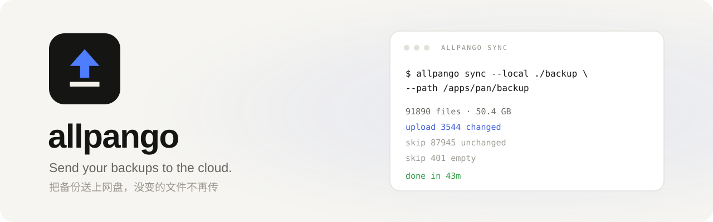
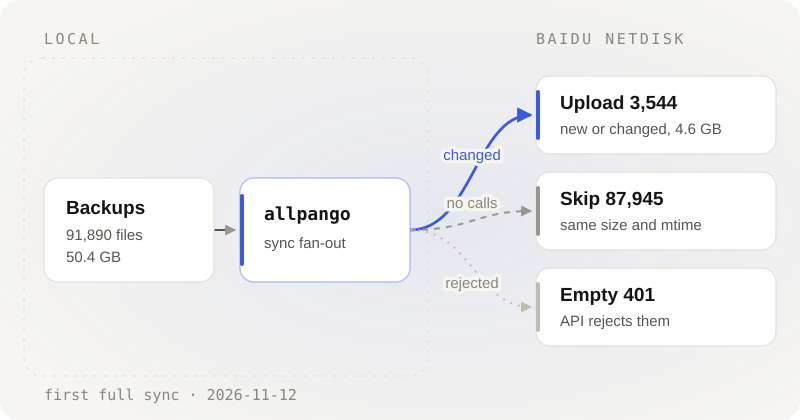

<p align="center">
  <picture>
    <source media="(prefers-color-scheme: dark)" srcset="docs/images/banner-dark.svg">
    
  </picture>
</p>

<p align="center"><sub>Log in · list · upload · sync · verify</sub></p>

<p align="center">
  <a href="https://github.com/CSGrandeur/allpango/releases/latest"></a>
  <a href="go.mod"></a>
  <a href="#install"></a>
  <a href="LICENSE"></a>
</p>

<p align="center">
  <a href="README.md">简体中文</a> · <b>English</b>
  <br>
  <a href="#install">Install</a> · <a href="#log-in">Log in</a> · <a href="#usage">Usage</a> · <a href="#sync-and-verify">Sync &amp; verify</a> · <a href="#limits">Limits</a> · <a href="#faq">FAQ</a>
</p>

<br>

allpango backs up a local directory to Baidu Netdisk. Each day's dumps go up; files that have not changed are not sent again. One static binary, no runtime dependencies.

It uploads and overwrites. There are no delete or move commands. Baidu Netdisk is what it talks to today.

## Features

- Login uses a device code, so no callback URL is needed. The access token refreshes before it expires and the new refresh token goes back into the file.
- Uploads follow the three official steps: precreate, slices, create. A same-name file is overwritten, not saved as `name(1)`. Past 1024 slices the slice size grows on its own.
- `sync` keeps a local manifest of what it has sent (size and mtime) and stops asking the disk about the rest. Delete the manifest and it gets slower, not wrong.
- `verify` ignores the manifest and asks the cloud directly, comparing size and mtime file by file. `sync --seed` rebuilds the manifest from a cloud listing; use `--seed-legacy` when taking over another tool's directory, where only size is comparable.
- Credentials, token and directories are all required. Nothing is guessed. Exit 0 on success, non-zero otherwise.

## Install

Requires Go 1.22+, or download the static binary for your platform from [Releases](https://github.com/CSGrandeur/allpango/releases/latest).

```bash
go build -o allpango ./cmd/allpango
```

## Log in

Create an app on the [Baidu Netdisk Open Platform](https://pan.baidu.com/union/console/applist) and put its keys in a credentials file:

```json
{ "app_key": "your AppKey", "app_secret": "your SecretKey" }
```

```bash
allpango login --cred cred.json --token token.json
```

The program prints a user code and a verification URL; sign in to your Baidu account in a browser and enter the code. The token is written to `token.json` (0600) and refreshed automatically afterwards. Credentials and tokens are read only from the files you name — never printed, never built in.

> [!NOTE]
> An app can only write under its own `/apps/<appname>` directory. To upload into an existing backup directory, use the keys of the app that created it.

## Usage

```bash
allpango quota  --cred cred.json --token token.json
allpango ls     --cred cred.json --token token.json --path /apps/<appname>/backup
allpango upload --cred cred.json --token token.json --local ./db.sql.gz --path /apps/<appname>/backup/db.sql.gz
allpango sync   --cred cred.json --token token.json --local ./backup --path /apps/<appname>/backup --manifest backup.mf.json
allpango verify --cred cred.json --token token.json --local ./backup --path /apps/<appname>/backup
```

| Command | Purpose |
| --- | --- |
| `login` | Device-code authorization, creates the token file |
| `refresh` | Refresh the token manually |
| `quota` | Total / used / free space |
| `ls` | List a directory: name, size, mtime |
| `upload` | Upload one file, overwrite the same name |
| `sync` | Incremental sync; `--seed`/`--seed-legacy` rebuilds the manifest from the cloud |
| `verify` | Per-file check against the cloud; non-zero exit on mismatch; `--size-only` compares size only (legacy takeovers) |

`quota` / `ls` / `sync` / `verify` accept `--json`; `sync -v` prints per-file progress.

## Sync and verify

<p align="center">
  <picture>
    <source media="(prefers-color-scheme: dark)" srcset="docs/images/flow-en-dark.svg">
    
  </picture>
</p>

The manifest records that a file was sent successfully once. It does not claim the cloud still has it. If the manifest is gone, or something else changed the cloud, `sync` precreates each file and lets the disk decide.

Change detection uses size and mtime, not hashes. A backup directory is mostly fresh dumps each day, so mtime is enough. Precreate carries the whole-file MD5, and the disk may take the content without slices.

A scheduled job can run `verify` after `sync`; it asks the cloud directly.

## Limits

- Per-file cap depends on the account: 4GB normal, 10GB member, 20GB super member. At most 1024 slices.
- Empty files cannot go up; the API rejects them. They are logged and skipped, not counted as failures.
- The md5 in a listing is a cloud hash, not the file's real MD5. Do not compare it with a local one.
- Rapid upload is the disk's call. On some accounts identical content still goes up in slices; the saving then comes from the requests you skip.

## FAQ

<details>
<summary><b>How is the token stored?</b></summary>

In the file you pass to `--token`, mode 0600. A refresh writes a temp file and renames it. The refresh token is good for one use: each refresh replaces it and kills the old one, so do not edit the file by hand and do not let two processes share a copy.

</details>

<details>
<summary><b>What if the refresh token stops working?</b></summary>

Run `login` again. A failed refresh usually means the token is already dead; retrying the old value will not help.

</details>

<details>
<summary><b>Will it delete remote files?</b></summary>

No. There are no delete or move commands in the program. Sync only deals with files that exist locally; anything extra on the cloud is left alone.

</details>

<details>
<summary><b>Does an interrupted sync re-upload everything?</b></summary>

No. The manifest is written after each file, so a re-run skips what already went up. The one that was cut off is precreated again and the disk decides where to pick up.

</details>

## Development

```bash
go test ./...
go build -o allpango ./cmd/allpango
```

---

<p align="center">
  <br>
  <sub><a href="LICENSE">MIT</a> © 2026 CSGrandeur · <a href="CHANGELOG.md">Changelog</a></sub>
</p>