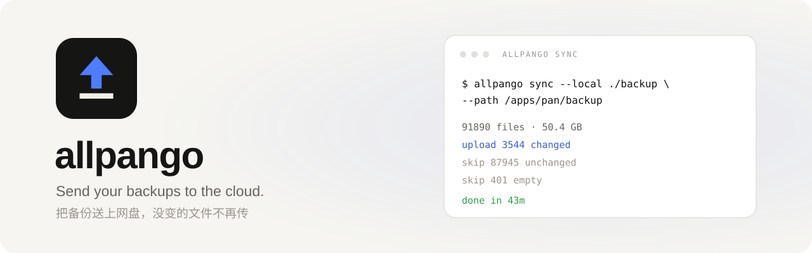
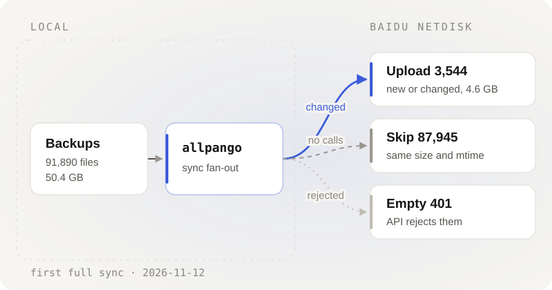

<p align="center">
  <picture>
    <source media="(prefers-color-scheme: dark)" srcset="docs/images/banner-dark.svg">
    
  </picture>
</p>

<p align="center">
  <a href="https://github.com/CSGrandeur/allpango/releases/latest"></a>
  <a href="go.mod"></a>
  <a href="#install"></a>
  <a href="LICENSE"></a>
</p>

<p align="center">
  <a href="#install">Install</a>&nbsp;&nbsp;·&nbsp;&nbsp;<a href="#log-in">Log in</a>&nbsp;&nbsp;·&nbsp;&nbsp;<a href="#usage">Usage</a>&nbsp;&nbsp;·&nbsp;&nbsp;<a href="#sync-and-verify">Sync and verify</a>&nbsp;&nbsp;·&nbsp;&nbsp;<a href="#limits">Limits</a>&nbsp;&nbsp;·&nbsp;&nbsp;<a href="#faq">FAQ</a>
  <br>
  <sub><a href="README.md">简体中文</a>&nbsp;&nbsp;|&nbsp;&nbsp;<b>English</b></sub>
</p>

<br>

allpango backs up a local directory to Baidu Netdisk or Tencent Weiyun. Each day's dumps go up; files that have not changed are not sent again. One static binary, no runtime dependencies.

It uploads and creates directories, with no delete or move commands. One config file can hold both remotes so a single command syncs them in sequence.

## Features

- Baidu Netdisk uses device-code login with no callback URL. The access token refreshes before expiry and writes the new refresh token back to disk. Uploads run in three steps (`precreate`, slices, `create`), overwrite same-name files instead of creating `name(1)`, and grow the slice size past 1024 parts.
- Tencent Weiyun uses the official MCP HTTP interface with only a token file. Uploads check streaming SHA-1 states in 512 KB slices, cache directories to cut down listing calls, and rapid-upload when identical content already exists.
- `sync` skips unchanged files via a local manifest (size and mtime); `verify` checks directly against the cloud; `sync --seed` rebuilds the manifest from a cloud listing. Each manifest binds its provider and remote root to prevent cross-drive reuse.
- You can pass credentials directly (Weiyun is auto-detected from its token file) or put remotes in `allpango.json` and run `--all` or `-r baidu,weiyun`. Credentials, tokens and paths are all required; exit 0 on success, non-zero otherwise.

## Install

Download a binary from [Releases](https://github.com/CSGrandeur/allpango/releases/latest). Builds are provided for Linux and macOS on amd64 / arm64 and Windows on amd64, with `SHA256SUMS.txt`.

Or install with Go 1.22+:

```bash
go install github.com/CSGrandeur/allpango/cmd/allpango@latest
```

## Log in

Credentials and tokens are read only from the files you name, saved with mode 0600, never printed and never built in.

### Baidu Netdisk

Create an app on the [Baidu Netdisk Open Platform](https://pan.baidu.com/union/console/applist) and put its keys in a credentials file:

```json
{ "app_key": "your AppKey", "app_secret": "your SecretKey" }
```

```bash
allpango login --cred baidu-cred.json --token baidu-token.json
```

The program prints a user code and a verification URL. Sign in to your Baidu account in a browser and enter the code; the token is written to `baidu-token.json` and refreshed automatically afterwards.

> [!NOTE]
> A Baidu app can only write under `/apps/<appname>`; the examples below use `myapp`. To upload into an existing backup directory, use the keys of the app that created it.

### Tencent Weiyun

Sign in on the [Weiyun OpenClaw page](https://www.weiyun.com/act/openclaw) to get your `mcp_token`. Run `login` and paste either the raw token or JSON; allpango verifies it online before saving:

```bash
allpango login -p weiyun --token weiyun-token.json
```

If you already have an OpenClaw token file (`{"mcp_token": "..."}`), passing `--token weiyun-token.json` is enough for subsequent commands — `-p weiyun` and `--cred` are not needed.

## Usage

### Single remote

```bash
# Baidu Netdisk
bd="--cred baidu-cred.json --token baidu-token.json"
allpango quota  $bd
allpango ls     $bd --path /apps/myapp/backup
allpango sync   $bd --local ./backup --path /apps/myapp/backup --manifest baidu.mf.json
allpango verify $bd --local ./backup --path /apps/myapp/backup

# Tencent Weiyun (auto-detected from token file; paths start at drive root)
wy="--token weiyun-token.json"
allpango ls     $wy --path /Backups/backup
allpango upload $wy --local ./db.sql.gz --path /Backups/backup/db.sql.gz
allpango sync   $wy --local ./backup --path /Backups/backup --manifest weiyun.mf.json
allpango verify $wy --local ./backup --path /Backups/backup
```

### Multi-cloud backup

Write an `allpango.json` config pointing to your key/token files (inline secrets are rejected):

```json
{
  "remotes": {
    "baidu": {
      "provider": "baidu",
      "cred": "baidu-cred.json",
      "token": "baidu-token.json",
      "path": "/apps/myapp/backup",
      "manifest": "baidu.mf.json"
    },
    "weiyun": {
      "provider": "weiyun",
      "token": "weiyun-token.json",
      "path": "/Backups/backup",
      "manifest": "weiyun.mf.json"
    }
  }
}
```

Relative file paths resolve against the config file directory (`~/` is supported). Failure on one remote does not stop the others, and the process exits non-zero if any remote failed.

```bash
allpango remotes -c allpango.json
allpango ls      -c allpango.json -r weiyun
allpango sync    -c allpango.json --all --local ./backup
allpango verify  -c allpango.json -r baidu,weiyun --local ./backup
```

| Command | Purpose | Common flags |
| :-- | :-- | :-- |
| `remotes` | List configured remotes and default paths | `-c` `--json` |
| `login` | Device-code login (Baidu) / token check (Weiyun) | `-p` `--cred` `--token` `-c` `-r` |
| `refresh` | Refresh token (Baidu) / verify token (Weiyun) | `--cred` `--token` `-c` `-r` |
| `quota` | Total, used and free space (Baidu) | `--cred` `--token` `--json` |
| `ls` | List a directory: name, size, mtime | `--path` `--json` `-c` `-r` |
| `upload` | Upload one file | `--local` `--path` `-c` `-r` |
| `sync` | Incremental sync of a whole directory | `--manifest` `--parallel` `--all`<br>`--seed` `--seed-legacy` `--json` |
| `verify` | Per-file check against the cloud, non-zero on mismatch | `--size-only` `--all` `--json` |

Add `-v` for per-file progress. `sync` uploads 4 files concurrently by default (`--parallel` changes it). Multi-remote `--json` wraps results in `{"results": [...]}`.

## Sync and verify

<p align="center">
  <picture>
    <source media="(prefers-color-scheme: dark)" srcset="docs/images/flow-en-dark.svg">
    
  </picture>
</p>

The manifest records that a file went up once, and binds `provider` and `remote_root` so a Baidu manifest cannot be reused for Weiyun or another directory. If the manifest is gone, or something else changed the cloud, `sync` precreates each file and lets the cloud decide on slices.

Local change detection uses size and mtime, not hashes; daily dump directories do not need full re-hashing. Because Weiyun's MCP upload does not store a client `local_mtime`, `verify` and `sync --seed` on Weiyun compare file size while the local manifest still tracks size and mtime.

To take over a directory another tool uploaded, run `sync --seed` once to rebuild the manifest from the cloud listing. If an older Baidu tool wrote upload timestamps instead of file mtimes, use `--seed-legacy` and `verify --size-only`. A scheduled job can run `verify` after `sync`; it asks the cloud directly.

## Limits

- Empty files cannot be uploaded on either drive; they are logged and skipped without failing the run. No delete or move commands exist, so extra remote files are counted and left untouched.
- On Baidu Netdisk, the per-file cap depends on the account (4 GB normal, 10 GB member, 20 GB super member), with at most 1024 slices. The `md5` in listings is a cloud hash, not the file's real MD5. Rapid upload is up to the server; some accounts still upload slices for identical content.
- On Tencent Weiyun, slices are fixed at 512 KB encoded as JSON Base64 (~33% wire overhead). Daily MCP quotas apply (`117401` stops immediately without retrying), no quota query endpoint exists (`quota` returns an error), and identical content hits rapid upload while different content under an existing name keeps the original and saves a `name(1)` copy.

## FAQ

<details>
<summary><b>Where is the token stored, and does it rotate?</b></summary>
<br>

In the file passed to `--token`, mode 0600, written via a temp file and atomic rename. Baidu's `refresh_token` is single-use and rotates on every refresh — never edit it by hand or share one file between two processes. Weiyun uses a static `mcp_token` until you reset it or it expires on OpenClaw.

</details>

<details>
<summary><b>What if a token stops working?</b></summary>
<br>

Run `login` again. On Baidu a failed refresh means the `refresh_token` is already dead; on Weiyun HTTP 401 or `117402` / `117407` means you need a fresh `mcp_token` from OpenClaw.

</details>

<details>
<summary><b>Will it delete remote files?</b></summary>
<br>

No. There are no delete or move commands in the program. Sync only deals with files that exist locally; anything extra on the cloud is left alone.

</details>

<details>
<summary><b>Does an interrupted sync re-upload everything?</b></summary>
<br>

No. The manifest is written after each file, so a re-run skips what already went up. The file that was cut off is precreated again, and the cloud decides where to resume or whether content already exists.

</details>

## Development

```bash
go test ./...
go build -o allpango ./cmd/allpango
```

<br>

<p align="center">
  <picture>
    <source media="(prefers-color-scheme: dark)" srcset="assets/mark_dark.svg">
    
  </picture>
  <br>
  <sub><a href="LICENSE">MIT</a> © 2026 CSGrandeur&nbsp;&nbsp;·&nbsp;&nbsp;<a href="CHANGELOG.md">Changelog</a></sub>
</p>
