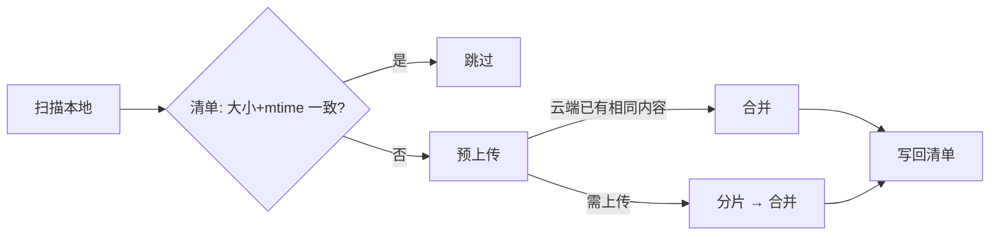

<p align="center">
  <picture>
    <source media="(prefers-color-scheme: dark)" srcset="docs/images/banner-dark.svg">
    
  </picture>
</p>

<p align="center"><sub>登录 · 列目录 · 上传 · 同步 · 核对</sub></p>

<p align="center">
  <a href="https://github.com/CSGrandeur/allpango/releases/latest"></a>
  <a href="go.mod"></a>
  <a href="#安装"></a>
  <a href="LICENSE"></a>
</p>

<p align="center">
  <b>简体中文</b> · <a href="README.en.md">English</a>
  <br>
  <a href="#安装">安装</a> · <a href="#登录">登录</a> · <a href="#使用">使用</a> · <a href="#同步与核对">同步与核对</a> · <a href="#限制">限制</a> · <a href="#常见问题">常见问题</a>
</p>

<br>

allpango 把本地目录备份到百度网盘：传新增和修改过的文件，跳过未变化的，空文件记录后略过。单个静态二进制，无运行时依赖；不删除、不移动云端文件。首个支持的盘是百度网盘，后续网盘沿用同一套命令。

## 功能

- **设备码登录。** 无需回调地址；access token 到期前自动刷新，新 refresh token 原子写回令牌文件。
- **官方上传流程。** 预上传 → 分片 → 合并；`rtype=3` 覆盖同名，不产生 `name(1)`；分片数超限自动放大分片。
- **增量同步。** 本地清单记录已上传文件的大小与修改时间，未变化的不再请求网盘；清单丢失仅损失速度，不影响正确性。
- **独立核对。** `verify` 递归列云端，逐文件比对大小与修改时间，不依赖清单；`sync --seed` 按云端列表重建清单；`--seed-legacy` 只按大小对账，用于接管其他工具上传的目录（其时间戳语义不同）。
- **明确失败。** 凭证、令牌、目录必须显式指定；成功退出 0，失败非 0。

## 安装

需要 Go 1.22+，或从 [Releases](https://github.com/CSGrandeur/allpango/releases/latest) 下载对应平台的静态二进制。

```bash
go build -o allpango ./cmd/allpango
```

## 登录

在[百度网盘开放平台](https://pan.baidu.com/union/console/applist)创建应用，将密钥写入凭证文件：

```json
{ "app_key": "你的 AppKey", "app_secret": "你的 SecretKey" }
```

```bash
allpango login --cred cred.json --token token.json
```

程序打印用户码与验证网址；在浏览器登录百度账号并输入用户码确认。令牌写入 `token.json`（0600），此后自动刷新。凭证与令牌仅从指定文件读取，不打印、不内置。

> [!NOTE]
> 应用只能写自己的 `/apps/<应用名>` 目录。向既有备份目录上传，须使用创建该目录的应用密钥。

## 使用

```bash
allpango quota  --cred cred.json --token token.json
allpango ls     --cred cred.json --token token.json --path /apps/<应用名>/backup
allpango upload --cred cred.json --token token.json --local ./db.sql.gz --path /apps/<应用名>/backup/db.sql.gz
allpango sync   --cred cred.json --token token.json --local ./backup --path /apps/<应用名>/backup --manifest backup.mf.json
allpango verify --cred cred.json --token token.json --local ./backup --path /apps/<应用名>/backup
```

| 命令 | 作用 |
| --- | --- |
| `login` | 设备码授权，生成令牌文件 |
| `refresh` | 手动刷新令牌 |
| `quota` | 总容量 / 已用 / 剩余 |
| `ls` | 列目录：名称、大小、修改时间 |
| `upload` | 上传单文件，覆盖同名 |
| `sync` | 增量同步；`--seed`/`--seed-legacy` 按云端列表重建清单 |
| `verify` | 逐文件核对，不一致退出非 0；`--size-only` 只比大小（接管旧工具目录） |

`quota` / `ls` / `sync` / `verify` 支持 `--json`；`sync -v` 输出逐文件进度。

## 同步与核对



清单语义是「上次成功上传」，而非「云端当前一定存在」。清单丢失或云端被外部修改时，同步退回逐文件预上传，由网盘判定，不会漏传。变化判定用大小与修改时间，不算哈希——备份目录以每日新生成的库包为主，mtime 足以区分；内容一致性由预上传携带的整文件 MD5 保证。

`verify` 与清单无关，直接比对云端，适合定时任务在 `sync` 后作独立校验。

## 限制

- 单文件上限随账号：普通 4GB / 会员 10GB / 超级会员 20GB；分片 ≤1024。
- 空文件无法上传（官方接口限制），记录后跳过，不计失败。
- 列表返回的 md5 为云端哈希，非文件真实 MD5，不可与本地比对。
- 秒传由网盘决定；部分账号同内容重传仍需分片，此时增量收益来自清单。

## 常见问题

<details>
<summary><b>令牌如何保存？</b></summary>

`--token` 指定的文件，0600，仅当前用户可读；刷新时先写临时文件再改名，不会写一半。refresh token 一次性：每次刷新即轮换，旧值作废。勿手工编辑，勿多进程共用同一份。

</details>

<details>
<summary><b>refresh token 失效怎么办？</b></summary>

重新 `login`。刷新失败通常意味着 refresh token 已作废，重试旧值无效。

</details>

<details>
<summary><b>会删除云端文件吗？</b></summary>

不会。没有删除与移动命令；同步只处理本地存在的文件，云端多余文件不动。

</details>

<details>
<summary><b>同步中断需要全部重传吗？</b></summary>

不需要。每个文件成功后即写回清单，重跑跳过已完成部分；中断的文件重新预上传，由网盘决定续传位置。

</details>

## 开发

```bash
go test ./...
go build -o allpango ./cmd/allpango
```

---

<p align="center">
  <br>
  <sub><a href="LICENSE">MIT</a> © 2026 CSGrandeur · <a href="CHANGELOG.md">更新日志</a></sub>
</p>