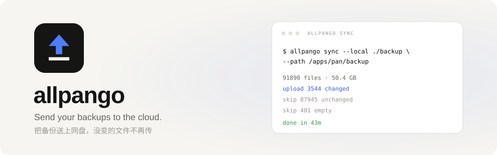

<p align="center">
  <picture>
    <source media="(prefers-color-scheme: dark)" srcset="docs/images/banner-dark.svg">
    
  </picture>
</p>

<p align="center">
  <a href="https://github.com/CSGrandeur/allpango/releases/latest"></a>
  <a href="go.mod"></a>
  <a href="#安装"></a>
  <a href="LICENSE"></a>
</p>

<p align="center">
  <a href="#安装">安装</a>&nbsp;&nbsp;·&nbsp;&nbsp;<a href="#登录">登录</a>&nbsp;&nbsp;·&nbsp;&nbsp;<a href="#使用">使用</a>&nbsp;&nbsp;·&nbsp;&nbsp;<a href="#同步与核对">同步与核对</a>&nbsp;&nbsp;·&nbsp;&nbsp;<a href="#限制">限制</a>&nbsp;&nbsp;·&nbsp;&nbsp;<a href="#常见问题">常见问题</a>
  <br>
  <sub><b>简体中文</b>&nbsp;&nbsp;|&nbsp;&nbsp;<a href="README.en.md">English</a></sub>
</p>

<br>

allpango 把本地目录备份到百度网盘或腾讯微云。每天生成的库包传上去，没改过的文件不再传一遍。一个静态二进制，没有运行时依赖。

它只上传和建目录，没有删除和移动命令。两个网盘可以写进同一份配置，一条命令依次同步。

## 功能

- 百度网盘走设备码登录，不需回调地址；access token 到期前自动刷新，新 refresh token 写回文件。上传按预上传、分片、合并三段走，同名覆盖，超 1024 片自动放大分片。
- 腾讯微云走官方 MCP HTTP 接口，只需一个令牌文件，按流式 SHA1 状态与 512 KB 分片上传，目录缓存减少列目录次数，命中相同内容直接秒传。
- `sync` 用本地清单记住传过的文件（大小和修改时间），没变的不再问网盘。清单绑定网盘类型与目标目录，跨盘或跨目录直接拦截。
- `verify` 不看清单，直接列云端逐个核对；`sync --seed` 按云端列表重建清单。
- 可以单盘直连传参，也可以写一份 `allpango.json` 管理多个网盘，用 `--all` 或 `-r baidu,weiyun` 一次同步和核对。凭证、令牌、目录都要显式给，成功退出 0，失败非 0。

## 安装

从 [Releases](https://github.com/CSGrandeur/allpango/releases/latest) 下载对应平台的二进制，提供 Linux 与 macOS 的 amd64 / arm64、Windows amd64，附 `SHA256SUMS.txt`。

或者用 Go 1.22+ 安装：

```bash
go install github.com/CSGrandeur/allpango/cmd/allpango@latest
```

## 登录

凭证和令牌只从指定的文件读取，以 0600 权限保存，不打印，也不内置。

### 百度网盘

在[百度网盘开放平台](https://pan.baidu.com/union/console/applist)创建应用，把密钥写进凭证文件：

```json
{ "app_key": "你的 AppKey", "app_secret": "你的 SecretKey" }
```

```bash
allpango login --cred baidu-cred.json --token baidu-token.json
```

程序打印用户码和验证网址。在浏览器登录百度账号并输入用户码确认，令牌写进 `baidu-token.json`，此后自动刷新。

> [!NOTE]
> 百度应用只能写自己的 `/apps/<应用名>` 目录，下文以 `myapp` 为例。要往已有的备份目录里传，须用创建该目录的应用密钥。

### 腾讯微云

打开[微云 OpenClaw 页面](https://www.weiyun.com/act/openclaw)登录账号并获取 `mcp_token`，执行后按提示粘贴令牌或整段 JSON，程序在线验活后写盘：

```bash
allpango login -p weiyun --token weiyun-token.json
```

如果本地已经有 OpenClaw 格式的令牌文件（`{"mcp_token": "..."}`），后续命令只要传 `--token weiyun-token.json` 就会自动识别为微云，不再需要 `-p weiyun` 或 `--cred`。

## 使用

### 单网盘直连

```bash
# 百度网盘
bd="--cred baidu-cred.json --token baidu-token.json"
allpango quota  $bd
allpango ls     $bd --path /apps/myapp/backup
allpango sync   $bd --local ./backup --path /apps/myapp/backup --manifest baidu.mf.json
allpango verify $bd --local ./backup --path /apps/myapp/backup

# 腾讯微云（按令牌文件自动识别，路径从网盘根起算）
wy="--token weiyun-token.json"
allpango ls     $wy --path /备份/backup
allpango upload $wy --local ./db.sql.gz --path /备份/backup/db.sql.gz
allpango sync   $wy --local ./backup --path /备份/backup --manifest weiyun.mf.json
allpango verify $wy --local ./backup --path /备份/backup
```

### 多网盘同时备份

写一份 `allpango.json`（只填文件路径，禁止把密钥直接写进配置）：

```json
{
  "remotes": {
    "baidu": {
      "provider": "baidu",
      "cred": "baidu-cred.json",
      "token": "baidu-token.json",
      "path": "/apps/myapp/backup",
      "manifest": "baidu.mf.json"
    },
    "weiyun": {
      "provider": "weiyun",
      "token": "weiyun-token.json",
      "path": "/备份/backup",
      "manifest": "weiyun.mf.json"
    }
  }
}
```

相对路径按配置文件所在目录解析（支持 `~/`）。单盘失败不阻断其余网盘执行，全部结束后若有失败则退出非 0。

```bash
allpango remotes -c allpango.json
allpango ls      -c allpango.json -r weiyun
allpango sync    -c allpango.json --all --local ./backup
allpango verify  -c allpango.json -r baidu,weiyun --local ./backup
```

| 命令 | 作用 | 常用参数 |
| :-- | :-- | :-- |
| `remotes` | 列出配置里的网盘与默认目录 | `-c` `--json` |
| `login` | 百度设备码授权 / 微云粘贴令牌验活 | `-p` `--cred` `--token` `-c` `-r` |
| `refresh` | 百度刷新令牌 / 微云在线验活 | `--cred` `--token` `-c` `-r` |
| `quota` | 百度网盘总容量、已用、剩余 | `--cred` `--token` `--json` |
| `ls` | 列目录：名称、大小、修改时间 | `--path` `--json` `-c` `-r` |
| `upload` | 上传单个文件 | `--local` `--path` `-c` `-r` |
| `sync` | 增量同步整个目录 | `--manifest` `--parallel` `--all`<br>`--seed` `--seed-legacy` `--json` |
| `verify` | 逐文件核对，不一致时退出非 0 | `--size-only` `--all` `--json` |

加 `-v` 输出逐文件进度；`sync` 默认同时传 4 个文件，可用 `--parallel` 调整；`--json` 对多网盘返回 `{"results": [...]}`。

## 同步与核对

<p align="center">
  <picture>
    <source media="(prefers-color-scheme: dark)" srcset="docs/images/flow-zh-dark.svg">
    
  </picture>
</p>

清单记的是「上次传成功过」，且绑定了 `provider` 与 `remote_root`，不能把百度的清单拿给微云或别的目录复用。清单丢了，或者云端被别的程序动过，`sync` 会重新走预上传，由网盘决定传不传分片。

判断本地变化用大小和修改时间，不算内容哈希；备份目录多是每天新生成的库包，mtime 够用。微云上传接口不写入客户端 `local_mtime`，因此微云的 `verify` 与 `sync --seed` 按文件大小核对，本地清单仍同时记录大小和本地修改时间。

接管别的工具传过的目录时，先跑一次 `sync --seed` 按云端列表重建清单；如果旧工具写入的百度修改时间对不上，改用 `--seed-legacy` 只比大小，核对时加 `verify --size-only`。定时任务可以在 `sync` 之后跑一次 `verify`，它直接问云端。

## 限制

- 空文件两个盘的接口都不收，程序记一笔跳过，不算失败；没有删除与移动命令，云端多出的文件只统计不删。
- 百度网盘单文件上限看账号：普通用户 4 GB，会员 10 GB，超级会员 20 GB，分片最多 1024 个；列表里的 `md5` 是云端哈希，不能拿来和本地比；秒传由网盘决定，有的账号同内容仍需传分片。
- 腾讯微云分片固定 512 KB 且走 JSON Base64，传输体积多约三成；受 MCP 日配额限制，触发 `117401` 立即停止不重试；未提供容量查询接口，`quota` 显式报错；同内容重传走秒传，同名但内容不同时服务端保留原文件并生成 `name(1)` 副本。

## 常见问题

<details>
<summary><b>令牌存在哪里，会自动变化吗？</b></summary>
<br>

存在 `--token` 指定的文件里，权限 0600，更新时先写临时文件再改名。百度的 `refresh_token` 用一次就换一个，旧的当场作废，不要手工编辑，也不要让两个进程共用同一份令牌。微云使用固定 `mcp_token`，直到在 OpenClaw 页面重置或过期失效。

</details>

<details>
<summary><b>令牌失效怎么办？</b></summary>
<br>

重新跑 `login`。百度刷新失败说明 `refresh_token` 已作废；微云报 401 / `117402` / `117407` 时需重新从 OpenClaw 页面复制新令牌。

</details>

<details>
<summary><b>会删除云端文件吗？</b></summary>
<br>

不会。程序里没有删除和移动命令。同步只管本地有的文件，云端多出来的不动。

</details>

<details>
<summary><b>同步中断后要全部重传吗？</b></summary>
<br>

不用。每传完一个文件就写一次清单，重跑时跳过已传的。断在半路的那个重新预上传，由网盘决定是否续传或秒传。

</details>

## 开发

```bash
go test ./...
go build -o allpango ./cmd/allpango
```

<br>

<p align="center">
  <picture>
    <source media="(prefers-color-scheme: dark)" srcset="assets/mark_dark.svg">
    
  </picture>
  <br>
  <sub><a href="LICENSE">MIT</a> © 2026 CSGrandeur&nbsp;&nbsp;·&nbsp;&nbsp;<a href="CHANGELOG.md">更新日志</a></sub>
</p>
