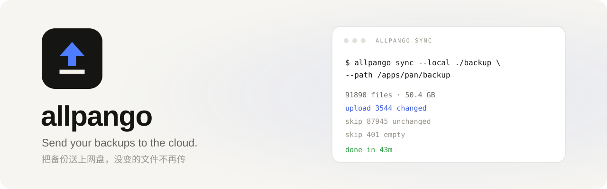
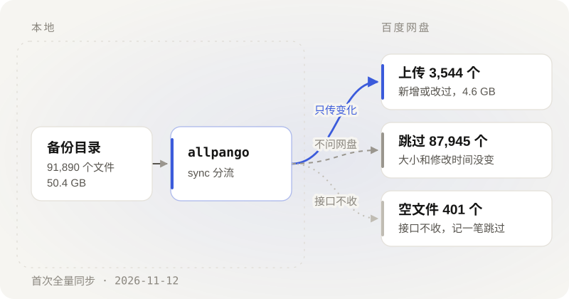

<p align="center">
  <picture>
    <source media="(prefers-color-scheme: dark)" srcset="docs/images/banner-dark.svg">
    
  </picture>
</p>

<p align="center"><sub>登录 · 列目录 · 上传 · 同步 · 核对</sub></p>

<p align="center">
  <a href="https://github.com/CSGrandeur/allpango/releases/latest"></a>
  <a href="go.mod"></a>
  <a href="#安装"></a>
  <a href="LICENSE"></a>
</p>

<p align="center">
  <b>简体中文</b> · <a href="README.en.md">English</a>
  <br>
  <a href="#安装">安装</a> · <a href="#登录">登录</a> · <a href="#使用">使用</a> · <a href="#同步与核对">同步与核对</a> · <a href="#限制">限制</a> · <a href="#常见问题">常见问题</a>
</p>

<br>

allpango 把本地目录备份到百度网盘。每天生成的库包传上去，没改过的文件不再传一遍。一个静态二进制，没有运行时依赖。

它只上传和覆盖，没有删除和移动命令。目前接的是百度网盘。

## 功能

- 登录走设备码，不需要回调地址。access token 到期前自动刷新，换回来的 refresh token 写回文件。
- 上传按官方三段走：预上传、分片、合并。同名文件覆盖，不会多出 `name(1)`。分片数超过 1024 时自动放大分片。
- `sync` 用一份本地清单记住传过的文件（大小和修改时间），没变的不再问网盘。清单删了只是慢一点，该传的照样传。
- `verify` 不看清单，直接列云端逐个比大小和修改时间。`sync --seed` 从云端列表重建清单；接管别的工具传过的目录用 `--seed-legacy`，只比大小。
- 凭证、令牌、目录都要显式给，不猜默认值。成功退出 0，失败非 0。

## 安装

需要 Go 1.22+，或从 [Releases](https://github.com/CSGrandeur/allpango/releases/latest) 下载对应平台的静态二进制。

```bash
go build -o allpango ./cmd/allpango
```

## 登录

在[百度网盘开放平台](https://pan.baidu.com/union/console/applist)创建应用，将密钥写入凭证文件：

```json
{ "app_key": "你的 AppKey", "app_secret": "你的 SecretKey" }
```

```bash
allpango login --cred cred.json --token token.json
```

程序打印用户码与验证网址；在浏览器登录百度账号并输入用户码确认。令牌写入 `token.json`（0600），此后自动刷新。凭证与令牌仅从指定文件读取，不打印、不内置。

> [!NOTE]
> 应用只能写自己的 `/apps/<应用名>` 目录。向既有备份目录上传，须使用创建该目录的应用密钥。

## 使用

```bash
allpango quota  --cred cred.json --token token.json
allpango ls     --cred cred.json --token token.json --path /apps/<应用名>/backup
allpango upload --cred cred.json --token token.json --local ./db.sql.gz --path /apps/<应用名>/backup/db.sql.gz
allpango sync   --cred cred.json --token token.json --local ./backup --path /apps/<应用名>/backup --manifest backup.mf.json
allpango verify --cred cred.json --token token.json --local ./backup --path /apps/<应用名>/backup
```

| 命令 | 作用 |
| --- | --- |
| `login` | 设备码授权，生成令牌文件 |
| `refresh` | 手动刷新令牌 |
| `quota` | 总容量 / 已用 / 剩余 |
| `ls` | 列目录：名称、大小、修改时间 |
| `upload` | 上传单文件，覆盖同名 |
| `sync` | 增量同步；`--seed`/`--seed-legacy` 按云端列表重建清单 |
| `verify` | 逐文件核对，不一致退出非 0；`--size-only` 只比大小（接管旧工具目录） |

`quota` / `ls` / `sync` / `verify` 支持 `--json`；`sync -v` 输出逐文件进度。

## 同步与核对

<p align="center">
  <picture>
    <source media="(prefers-color-scheme: dark)" srcset="docs/images/flow-zh-dark.svg">
    
  </picture>
</p>

清单记的是「上次传成功过」，不代表云端此刻还在。清单丢了，或者云端被别的程序动过，`sync` 会逐文件预上传，让网盘决定传不传。

判断变化用大小和修改时间，不算哈希。备份目录里多是每天新生成的库包，mtime 够用。预上传会带整文件 MD5，内容相同网盘可以不收分片。

定时任务可以在 `sync` 之后跑一次 `verify`，它直接问云端。

## 限制

- 单文件上限看账号：普通 4GB，会员 10GB，超级会员 20GB。分片最多 1024 个。
- 空文件传不上去，接口不收。程序记一笔跳过，不算失败。
- 列表里的 md5 是云端哈希，不是文件的真实 MD5，别拿来和本地比。
- 秒传由网盘说了算。有的账号同内容重传照样走分片，这时候快在省下的那些请求上。

## 常见问题

<details>
<summary><b>令牌如何保存？</b></summary>

在 `--token` 指定的文件里，权限 0600。刷新时先写临时文件再改名。refresh token 用一次就换一个，旧的当场作废，所以别手工改这个文件，也别让两个进程共用一份。

</details>

<details>
<summary><b>refresh token 失效怎么办？</b></summary>

重新跑 `login`。刷新失败一般就是 refresh token 已经作废了，拿旧值重试没用。

</details>

<details>
<summary><b>会删除云端文件吗？</b></summary>

不会。程序里没有删除和移动命令。同步只管本地有的文件，云端多出来的不动。

</details>

<details>
<summary><b>同步中断需要全部重传吗？</b></summary>

不用。每传完一个就写清单，重跑时跳过传过的。断在半路的那个重新预上传，网盘决定从哪接。

</details>

## 开发

```bash
go test ./...
go build -o allpango ./cmd/allpango
```

---

<p align="center">
  <br>
  <sub><a href="LICENSE">MIT</a> © 2026 CSGrandeur · <a href="CHANGELOG.md">更新日志</a></sub>
</p>