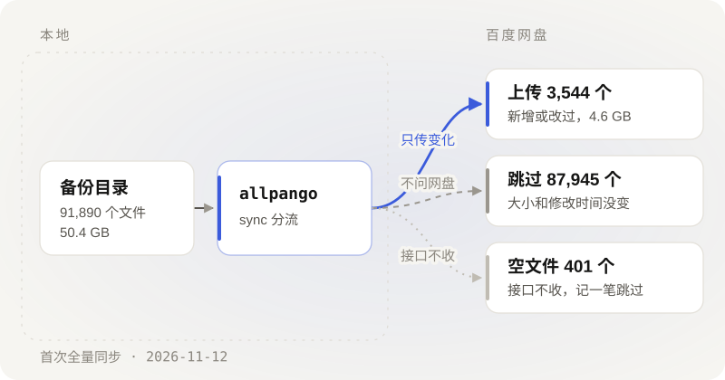

<p align="center">
  <picture>
    <source media="(prefers-color-scheme: dark)" srcset="docs/images/banner-dark.svg">
    
  </picture>
</p>

<p align="center">
  <a href="https://github.com/CSGrandeur/allpango/releases/latest"></a>
  <a href="go.mod"></a>
  <a href="#安装"></a>
  <a href="LICENSE"></a>
</p>

<p align="center">
  <a href="#安装">安装</a>&nbsp;&nbsp;·&nbsp;&nbsp;<a href="#登录">登录</a>&nbsp;&nbsp;·&nbsp;&nbsp;<a href="#使用">使用</a>&nbsp;&nbsp;·&nbsp;&nbsp;<a href="#同步与核对">同步与核对</a>&nbsp;&nbsp;·&nbsp;&nbsp;<a href="#限制">限制</a>&nbsp;&nbsp;·&nbsp;&nbsp;<a href="#常见问题">常见问题</a>
  <br>
  <sub><b>简体中文</b>&nbsp;&nbsp;|&nbsp;&nbsp;<a href="README.en.md">English</a></sub>
</p>

<br>

allpango 把本地目录备份到百度网盘。每天生成的库包传上去，没改过的文件不再传一遍。一个静态二进制，没有运行时依赖。

它只上传和覆盖，没有删除和移动命令。

## 功能

- 登录走设备码，不需要回调地址。access token 到期前自动刷新，换回来的 refresh token 写回文件。
- 上传按官方三段走：预上传、分片、合并。同名文件直接覆盖，不会多出 `name(1)`；分片数超过 1024 时自动放大分片。
- `sync` 用一份本地清单记住传过的文件（大小和修改时间），没变的不再问网盘。清单删了只是慢一点，该传的照样传。
- `verify` 不看清单，直接列云端，逐个比大小和修改时间。
- 凭证、令牌、目录都要显式给，不猜默认值。成功退出 0，失败非 0。

## 安装

从 [Releases](https://github.com/CSGrandeur/allpango/releases/latest) 下载对应平台的二进制，提供 Linux 与 macOS 的 amd64 / arm64、Windows amd64，附 `SHA256SUMS.txt`。

或者用 Go 1.22+ 安装：

```bash
go install github.com/CSGrandeur/allpango/cmd/allpango@latest
```

## 登录

在[百度网盘开放平台](https://pan.baidu.com/union/console/applist)创建应用，把密钥写进凭证文件：

```json
{ "app_key": "你的 AppKey", "app_secret": "你的 SecretKey" }
```

```bash
allpango login --cred cred.json --token token.json
```

程序打印用户码和验证网址。在浏览器登录百度账号，输入用户码确认，令牌就写进 `token.json`（权限 0600），之后自动刷新。凭证和令牌只从指定文件读取，不打印，也不内置。

> [!NOTE]
> 应用只能写自己的 `/apps/<应用名>` 目录，下文以 `myapp` 为例。要往已有的备份目录里传，须用创建该目录的应用密钥。

## 使用

```bash
auth="--cred cred.json --token token.json"
dir=/apps/myapp/backup

allpango quota  $auth
allpango ls     $auth --path $dir
allpango upload $auth --local ./db.sql.gz --path $dir/db.sql.gz
allpango sync   $auth --local ./backup --path $dir --manifest backup.mf.json
allpango verify $auth --local ./backup --path $dir
```

| 命令 | 作用 | 常用参数 |
| :-- | :-- | :-- |
| `login` | 设备码授权，生成令牌文件 | |
| `refresh` | 手动刷新令牌 | |
| `quota` | 总容量、已用、剩余 | `--json` |
| `ls` | 列目录：名称、大小、修改时间 | `--path` `--json` |
| `upload` | 上传单个文件，覆盖同名 | `--local` `--path` |
| `sync` | 增量同步整个目录 | `--manifest` `--parallel` `--seed` `--seed-legacy` `--json` |
| `verify` | 逐文件核对，不一致时退出非 0 | `--size-only` `--json` |

每条命令都要带 `--cred` 和 `--token`，加 `-v` 输出逐文件进度。`sync` 默认同时传 4 个文件，用 `--parallel` 调整。

## 同步与核对

<p align="center">
  <picture>
    <source media="(prefers-color-scheme: dark)" srcset="docs/images/flow-zh-dark.svg">
    
  </picture>
</p>

清单记的是「上次传成功过」，不代表云端此刻还在。清单丢了，或者云端被别的程序动过，`sync` 会逐文件预上传，让网盘决定传不传。

判断变化用大小和修改时间，不算哈希。备份目录里多是每天新生成的库包，mtime 够用。预上传会带整文件 MD5，内容相同时网盘可以不收分片。

接管别的工具传过的目录时，先跑一次 `sync --seed`，按云端列表重建清单，已在云端的文件不再重传。那个工具记的修改时间对不上，就改用 `--seed-legacy` 只比大小，核对时相应加 `verify --size-only`。

定时任务可以在 `sync` 之后跑一次 `verify`，它直接问云端。

## 限制

- 单文件上限看账号：普通用户 4 GB，会员 10 GB，超级会员 20 GB。分片最多 1024 个。
- 空文件传不上去，接口不收。程序记一笔跳过，不算失败。
- 列表里的 md5 是云端哈希，不是文件的真实 MD5，不能拿来和本地比。
- 秒传由网盘决定。有的账号同内容重传照样走分片，这时省下的是逐个询问的那些请求。

## 常见问题

<details>
<summary><b>令牌存在哪里？</b></summary>
<br>

在 `--token` 指定的文件里，权限 0600。刷新时先写临时文件再改名。refresh token 用一次就换一个，旧的当场作废，所以不要手工改这个文件，也不要让两个进程共用一份。

</details>

<details>
<summary><b>refresh token 失效怎么办？</b></summary>
<br>

重新跑 `login`。刷新失败一般就是 refresh token 已经作废，拿旧值重试没用。

</details>

<details>
<summary><b>会删除云端文件吗？</b></summary>
<br>

不会。程序里没有删除和移动命令。同步只管本地有的文件，云端多出来的不动。

</details>

<details>
<summary><b>同步中断后要全部重传吗？</b></summary>
<br>

不用。每传完一个文件就写一次清单，重跑时跳过已传的。断在半路的那个重新预上传，由网盘决定从哪里接着传。

</details>

## 开发

```bash
go test ./...
go build -o allpango ./cmd/allpango
```

<br>

<p align="center">
  <picture>
    <source media="(prefers-color-scheme: dark)" srcset="assets/mark_dark.svg">
    
  </picture>
  <br>
  <sub><a href="LICENSE">MIT</a> © 2026 CSGrandeur&nbsp;&nbsp;·&nbsp;&nbsp;<a href="CHANGELOG.md">更新日志</a></sub>
</p>
